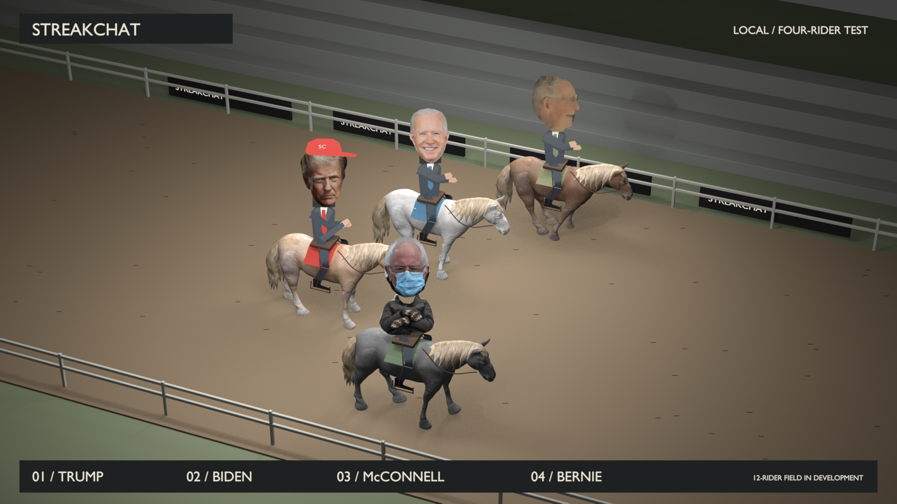

# HorseRace — StreakChat Blender prototype

A local horse-racing comedy prototype inspired by Japan World Cup: photographic cutout riders, stiff bodies, textured 3D horses, fast leg animation, and a Trump/Biden hat-throw interaction with existing recorded sound clips.

**Current version: [`cutout_v5`](cutout_v5/README.md).** Four riders are built: Donald Trump, Joe Biden, Mitch McConnell, and Bernie Sanders with his inauguration mittens. The target is a mixed cast of twelve. The twelve-horse layout contains four completed riders and eight open seats, not twelve completed characters.



## Open the project

- **Video:** [Four-rider MP4](cutout_v5/streakchat_four_riders.mp4).
- **Editable scene:** [Four-rider Blender project](cutout_v5/streakchat_four_riders.blend), with packed photographs, textures and dialogue.
- **Full-field layout:** [Twelve-horse Blender project](cutout_v5/field_12_capacity.blend) and [layout image](cutout_v5/field_12_capacity.png).
- **Casting:** [Proposed mixed twelve-rider roster](cutout_v5/ROSTER.md).

The binary scenes and media are included in ordinary Git; Git LFS is not required. Download the files using GitHub’s **Raw / Download** control, or clone the repository:

```sh
git clone https://github.com/IslandPlumber/HorseRace.git
cd HorseRace
```

For the interactive local preview, run Python from the project root:

```sh
python serve_preview.py
```

Then open **http://127.0.0.1:8768/cutout_v5/preview.html**. It contains the race video, twelve-horse layout, casting board, and scene download links. The server listens only on this computer and supports video seeking.

To open the scene directly, use Blender’s File → Open. Windows also has [`cutout_v5/Open_Blender_Preview.cmd`](cutout_v5/Open_Blender_Preview.cmd), configured for the tested Blender 5.2 installation. Adjust its Blender path if necessary.

## Render and rebuild

The tested renderer is **Blender 5.2.3 LTS, Eevee, Vulkan**, at **1600 × 900, 24 fps**. On the original test PC (AMD Radeon RX 6400), the four-second four-rider clip rendered in approximately **186 seconds**. The twelve-horse layout still took approximately **6 seconds**. These are measured offline render times, not an interactive-game frame-rate claim.

The saved `.blend` scenes can be opened without installing Python libraries. For the external audio preparation and verification scripts:

```sh
python -m pip install -r requirements.txt
```

See [`cutout_v5/README.md`](cutout_v5/README.md) for the build, staging-check, rendering and encoding sequence. Use `--gpu-backend vulkan` on the tested PC; its OpenGL driver crashed during earlier horse rendering. Render PNG sequences are regenerated by the scripts and are excluded from Git, along with logs, caches and `.blend1` backups.

## Project versions

| Folder | Prototype stage |
|---|---|
| Root files and `assets/` | Original stylized two-horse prototype and GLB exports; see [original notes](docs/original-prototype.md). |
| `cutout_v2/` | Photo cutout Trump/Biden, anatomical horses, fitted legs, attached/grabbed/thrown cap, and Biden recording. |
| `cutout_v3/` | McConnell’s blank-stare face and wider three-rider field. |
| `cutout_v4/` | Higher race camera, faster legs, Trump recording, and speech-only jaw movement. |
| `cutout_v5/` | Bernie with folded arms/mittens, four-rider sample, twelve-horse layout, and mixed casting board. |

Earlier source scenes remain included because the later build scripts extend them. Frame timing, staging checks, encoded-media checks and credits are preserved with each version.

## Sources and scope

See [`cutout_v5/CREDITS.md`](cutout_v5/CREDITS.md) for the CC0 horse, official portraits, third-party meme photographs and recorded excerpts. Assets retain their individual source/licensing status; this repository does not apply a blanket open-source license to third-party media.

This is an obvious cutout parody, not footage of a real event. No generated video, generated voice, or Higgsfield is used. The project is independent of the live StreakChat site and contains no deployment workflow or production connection.
